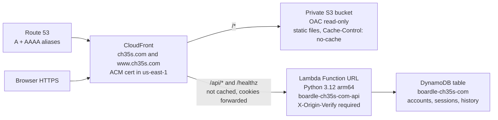

# Boardle runtime and operations

How to run, test, store data, and operate the personal edition in `personal/`.
Feature description and how to play are in [README.md](README.md). Step-by-step first
deploy to https://ch35s.com is in [aws/README-DEPLOY.md](aws/README-DEPLOY.md). The
single-server / Docker / App Runner alternative is in [DEPLOY_AWS.md](DEPLOY_AWS.md).

The current front-end release is **3.3** (`<meta name="boardle-version" content="3.3">`).

## Requirements

| What | Needed for |
|---|---|
| **Python 3** (standard library only) | `python3 serve.py` with the default SQLite store. No `pip` install. |
| **Node.js** | Front-end tests (`node test.mjs`, …). No npm packages are required. |
| **boto3 >= 1.28** | Only when `BOARDLE_STORAGE=dynamodb`. Listed in `requirements.txt`. |
| **moto[dynamodb] >= 5** (optional) | DynamoDB adapter tests. Without it, those tests are skipped. |
| **Docker** (optional) | Container in `Dockerfile` (`python:3.12-slim`, port 8000). |
| **AWS CLI v2**, `python3`, and `zip` | `aws/deploy.sh` / `aws/destroy.sh`. Works with macOS bash 3.2 and from zsh. |

The AWS Lambda runtime and the Docker image are **Python 3.12**. The local server
has no stricter pin than “Python 3 with the standard library.”

## Running locally

From this folder:

```bash
cd personal
python3 serve.py          # http://localhost:8000
python3 serve.py 8080     # a different port
```

The process binds a `ThreadingHTTPServer` and prints the URL plus the storage
path. Stop with Ctrl+C. The app must be served over HTTP(S): ES modules and
`fetch` do not work from `file://`. Any static file server also works for the
front end alone (`npx serve .`); without `serve.py` (or the AWS API) there is
no sign-in, and history stays in the browser as Guest.

A CLI port argument wins over the environment. Health check: `GET /healthz`
returns `{"ok": true}`.

Docker equivalent:

```bash
docker build -t boardle .
docker run --rm -p 8000:8000 -v boardle-data:/data boardle
```

The image sets `PORT=8000`, `BOARDLE_DB_PATH=/data/boardle.sqlite3`, and
`BOARDLE_COOKIE_SECURE=1`, and health-checks `/healthz`.

### Environment variables (local server and API)

All are optional. The API (`boardle_backend/api.py`) is shared by
`python3 serve.py` and the Lambda handler.

| Variable | Default | Meaning |
|---|---|---|
| `PORT` / `BOARDLE_PORT` | `8000` | Listen port (`serve.py` only; a CLI argument wins). |
| `BOARDLE_HOST` | empty (all interfaces) | Bind address (`serve.py` only). The startup banner still prints `localhost`. |
| `BOARDLE_STORAGE` | `sqlite` | `sqlite`, or `dynamodb` / `dynamo` / `ddb`. |
| `BOARDLE_DB_PATH` | `~/.boardle/boardle.sqlite3` | SQLite file. The parent directory is created if needed. |
| `BOARDLE_DDB_TABLE` | `boardle` | DynamoDB table name. |
| `AWS_REGION` / `AWS_DEFAULT_REGION` | (SDK default) | DynamoDB region. |
| `BOARDLE_DDB_ENDPOINT` | unset | Alternate DynamoDB endpoint (local emulator / tests). |
| `BOARDLE_ALLOW_REGISTER` | `1` | `1` / `true` / `yes` / `on` allow new accounts; `0` closes registration. |
| `BOARDLE_INVITE_CODE` | unset | If set, required to register (compared with `hmac.compare_digest`). |
| `BOARDLE_COOKIE_SECURE` | unset / false | `1` always marks the session cookie `Secure`. Also set automatically when the request is HTTPS (`X-Forwarded-Proto` or the Lambda front door). |
| `BOARDLE_SESSION_DAYS` | `30` | Session lifetime in days. |
| `BOARDLE_MAX_BODY` | `2000000` | Max request body size in bytes (413 if larger). |
| `BOARDLE_ALLOWED_ORIGINS` | empty | Extra comma-separated origins accepted for POST/PUT/DELETE, e.g. `https://ch35s.com,https://www.ch35s.com`. Same-host requests are always allowed. |
| `BOARDLE_QUIET` | unset | `1` suppresses `serve.py` access logs. |
| `BOARDLE_RATE_LIMIT` | `dynamodb` when storage is DynamoDB (Lambda) | `dynamodb` uses the shared table limiter; `memory` uses the in-process limiter. |

`serve.py` does not serve `/boardle_backend`, `/tests`, `/tools`, `/data`,
`/node_modules`, `/aws`, dotfiles, or suffixes such as `.py`, `.sh`, `.sqlite3`,
`.env`, `Dockerfile`. Static responses get `Cache-Control: no-cache`; API
responses get `no-store`.

## Data storage

### SQLite (default locally)

File: `~/.boardle/boardle.sqlite3` (outside the app folder, so updates do not
touch it). WAL mode and foreign keys are on. Tables:

```sql
users (
  username   TEXT PRIMARY KEY,
  pw_hash    TEXT NOT NULL,
  created_at REAL NOT NULL
);
sessions (
  token_hash TEXT PRIMARY KEY,
  username   TEXT NOT NULL REFERENCES users(username),
  expires_at REAL NOT NULL
);
history (
  username   TEXT PRIMARY KEY REFERENCES users(username),
  data       TEXT NOT NULL,   -- JSON object of "boardle:*" keys
  rev        INTEGER NOT NULL,
  updated_at REAL NOT NULL
);
```

History writes are optimistic: the client sends `baseRev`, and a mismatch
returns HTTP 409 with the current data and revision. Do not run more than one
server process against the same SQLite file; use DynamoDB for multiple
instances.

### DynamoDB (`BOARDLE_STORAGE=dynamodb`)

Single table, string partition key `pk` + sort key `sk`. History values are
zlib-compressed (`data_z`) to stay under the 400 KB item limit. The same
optimistic `rev` check is a conditional put. Item layout
(`boardle_backend/store_dynamodb.py`):

| pk | sk | Payload |
|---|---|---|
| `USER#<username>` | `PROFILE` | `pw_hash`, `created_at` |
| `USER#<username>` | `HISTORY` | `data_z`, `rev`, `updated_at` |
| `SESSION#<sha256>` | `SESSION` | `username`, `expires_at`, `ttl` |
| `RATE#<sha256>` | `W#<window>` | `hits`, `ttl` (failed-login counter) |

The deploy script names the table `boardle-ch35s-com` for domain `ch35s.com`
(on-demand billing, point-in-time recovery, TTL on the `ttl` attribute,
deletion protection). Expired sessions and rate-limit rows are cleaned up by
TTL; the API also rejects expired sessions itself because TTL deletion is lazy.

### Browser (Guest / offline)

With no backend, or while signed out, the front end uses `localStorage` keys
prefixed `boardle:`. Signed-in data is held in memory, cached under
`boardle:u:<username>` for offline use, and synced to `PUT /api/history`
(debounced full snapshot). Device-only keys that are never synced:
`boardle:seenHelp`, `boardle:migratedTo`, `boardle:lastUser`.

Guest data on a browser is merged into the **first** profile signed into on
that device and is not deleted. The API stores only keys whose names start
with `boardle:`.

Notable keys: `boardle:stats:<mode>`, `boardle:openings:cards`,
`boardle:openings:tests`, `boardle:openings:testrun:<variationId>`,
`boardle:settings:boardColors`, `boardle:history:log`.

## Accounts and sessions

Endpoints, all JSON (`Content-Type: application/json` is required on writes):

| Method | Path | Role |
|---|---|---|
| `GET` | `/healthz` | `{"ok": true}` |
| `GET` | `/api/me` | Whether a backend is present, current user (or `null`), and whether registration / an invite code is required |
| `POST` | `/api/register` | Create an account and start a session |
| `POST` | `/api/login` | Start a session |
| `POST` | `/api/logout` | Delete the session and clear the cookie |
| `GET` | `/api/history` | Signed-in player's key/value snapshot, `rev`, `updatedAt` |
| `PUT` | `/api/history` | Replace the snapshot; body `{ "data": {…}, "baseRev": N }` |

Usernames are normalized to lowercase and must match
`^[a-z0-9][a-z0-9_.-]{2,31}$` (3–32 characters). Passwords must be 8–256
characters. Passwords are hashed with **scrypt** (`n=2^14`, `r=8`, `p=1`);
if scrypt is unavailable the hash falls back to PBKDF2-HMAC-SHA256
(600,000 iterations).

The session cookie is `boardle_session`: `Path=/; HttpOnly; SameSite=Lax;
Max-Age=<session seconds>`, plus `Secure` behind HTTPS. The raw token is a
32-byte urlsafe secret; only its SHA-256 hex digest is stored. Failed logins
are limited to **10 tries per 15 minutes** per `IP|username`. Locally that
limiter is in process memory; on Lambda it is the DynamoDB `RATE#` rows (a
DynamoDB error fails open so a throttled table cannot lock everyone out).
Login timing uses a dummy hash when the username is unknown.

Write requests also check `Origin` (and `BOARDLE_ALLOWED_ORIGINS`) as a
CSRF defence.

## Cache and versioning

Every local module URL and the `style.css` / `app.js` tags in `index.html`
carry a release stamp (`?v=3.3`). That prevents a browser from mixing an old
cached file with a new one, which used to leave a blank board after an
update. After editing any `.js` or `.css` (except `vendor/`), bump it:

```bash
python3 tools/stamp_version.py 3.4
node test-version.mjs    # fails if any local import is missing the new ?v=
```

`serve.py` and the S3 upload both send `Cache-Control: no-cache` so the
browser revalidates (cheap 304s). If the app still fails to start,
`index.html` shows a **Reload fresh copy** button. After any deploy or folder
swap, hard-reload once (**Cmd+Shift+R** on a Mac, **Ctrl+Shift+R** elsewhere).

## Tests

From `personal/`:

```bash
npm test
# same steps, without npm:
node test.mjs && node openings/test-openings.mjs && node openings/test-testmode.mjs \
  && node test-storage.mjs && node test-version.mjs \
  && python3 -m unittest discover -s tests
```

| Command | Covers |
|---|---|
| `node test.mjs` | Puzzle scoring and that every bundled solution is legal in chess.js |
| `node openings/test-openings.mjs` | Lesson legality, spaced review, trainer invariants |
| `node openings/test-testmode.mjs` | Test-mode lines, ordering, unlocks, next-due |
| `node test-storage.mjs` | Guest vs signed-in storage, migration, merge, export/import |
| `node test-version.mjs` | Every local import carries the current `?v=` stamp |
| `python3 -m unittest discover -s tests` | `test_api.py` (register / login / history isolation on SQLite), `test_lambda.py`, `test_deploy_script.py` (deploy.sh / destroy.sh against a fake AWS CLI). DynamoDB store tests run only if boto3 and moto are installed. |

## AWS runtime architecture

Default resource prefix for `DOMAIN=ch35s.com` is `boardle-ch35s-com`
(`NAME=boardle-<domain-with-dashes>`). ACM certificates are always requested
in **us-east-1**; Lambda, DynamoDB, and S3 use `REGION` (default `us-east-1`).



CloudFront is the only caller that knows the random `X-Origin-Verify` secret
(Lambda env `BOARDLE_ORIGIN_VERIFY`). Hitting the raw `*.lambda-url.*`
address returns `{"error": "Forbidden"}`. The Function URL itself uses
`--auth-type NONE`. The Lambda is 512 MB, 10 s timeout, handler
`lambda_handler.handler`; the zip contains only `lambda_handler.py` and
`boardle_backend/*.py` (stdlib + the AWS runtime's boto3 — nothing else is
bundled). The IAM role may only `Get/Put/Update/DeleteItem` on that one
table and write its own log group.

The front end already calls `/api/me`, `/api/history`, and so on with
relative paths, so the same static files work locally and behind CloudFront.

## Deploy, update, status, destroy

Run these from `personal/` after `aws login` (or `aws configure sso` /
`aws configure`) and `aws sts get-caller-identity`. The first deploy takes
about 15–25 minutes, mostly waiting on ACM and CloudFront. Re-running
`deploy.sh` is safe: existing resources are reused.

```bash
chmod +x aws/deploy.sh aws/destroy.sh

# First deploy (or to change INVITE_CODE / ALLOW_REGISTER)
DOMAIN=ch35s.com REGION=us-east-1 ./aws/deploy.sh

# Later: new static files + Lambda code + CloudFront cache flush (~1 minute)
# Does not change Lambda environment variables; player data is not touched.
DOMAIN=ch35s.com ./aws/deploy.sh update

DOMAIN=ch35s.com ./aws/deploy.sh status
curl https://ch35s.com/healthz          # {"ok": true}
```

Script settings:

| Variable | Default | Meaning |
|---|---|---|
| `DOMAIN` | required | Apex domain whose public hosted zone is already in Route 53 |
| `REGION` | `us-east-1` | Lambda, DynamoDB, and S3 |
| `PROFILE` | unset | AWS CLI profile (`AWS_PROFILE`) |
| `NAME` | `boardle-<domain-with-dashes>` | Prefix for every resource name |
| `YES=1` | off | Do not ask before replacing existing apex/www A/AAAA records |
| `INVITE_CODE` | empty (or the value already on the function) | Required to register; letters, digits, `_ . -` only |
| `ALLOW_REGISTER` | `1` | `0` closes registration |
| `DELETE_DATA=1` | off | `destroy.sh` also deletes the DynamoDB table |
| `CONFIRM` | typed interactively | Set `CONFIRM=ch35s.com` to skip the destroy prompt |

```bash
# Site offline; accounts and history kept (table is reused by a later deploy)
DOMAIN=ch35s.com ./aws/destroy.sh

# Also delete the table. An on-demand backup is taken first.
DOMAIN=ch35s.com DELETE_DATA=1 ./aws/destroy.sh
```

`destroy.sh` only removes A/AAAA records that point at this distribution. The
hosted zone and other DNS records stay. Disabling CloudFront takes 5–15
minutes before it can be deleted; the script waits.

Resource names for `ch35s.com`: table `boardle-ch35s-com`, role
`boardle-ch35s-com-lambda`, function `boardle-ch35s-com-api`, bucket
`boardle-ch35s-com-site-<account-id>`, OAC `boardle-ch35s-com-oac`.

## Lambda environment

Set by `aws/deploy.sh` (full deploy, not `update`):

| Variable | Value |
|---|---|
| `BOARDLE_STORAGE` | `dynamodb` |
| `BOARDLE_DDB_TABLE` | the table name (`boardle-ch35s-com` by default) |
| `BOARDLE_COOKIE_SECURE` | `1` |
| `BOARDLE_ALLOWED_ORIGINS` | `https://<domain>,https://www.<domain>` |
| `BOARDLE_ORIGIN_VERIFY` | random secret generated on first create; kept on later deploys. Comma-separate two values to rotate without downtime. |
| `BOARDLE_ALLOW_REGISTER` | from `ALLOW_REGISTER` (default `1`) |
| `BOARDLE_INVITE_CODE` | from `INVITE_CODE` (default empty) |

## Logs

CloudWatch log group: `/aws/lambda/boardle-ch35s-com-api` (that is
`/aws/lambda/$NAME-api`). Retention is **30 days**. The deploy script creates
the group so the role only needs `logs:CreateLogStream` and `logs:PutLogEvents`.

```bash
aws logs tail /aws/lambda/boardle-ch35s-com-api --follow --region us-east-1
```

API exceptions are also written to stderr as `API error <method> <path>: …`.

## Backups

- **Local SQLite:** copy `~/.boardle/boardle.sqlite3`. WAL may also leave
  `boardle.sqlite3-wal` / `-shm` next to it; copy those too if the server is
  running, or stop `serve.py` first.
- **In-app:** 👤 → **Export history (JSON)** for the current player.
  **Import JSON** merges a file into the signed-in profile (or Guest).
- **DynamoDB:** the deploy script turns on point-in-time recovery (restore to
  any second of the last 35 days). You can also take an on-demand snapshot:
  `aws dynamodb create-backup --table-name boardle-ch35s-com --backup-name boardle-$(date +%F) --region us-east-1`.
- **`DELETE_DATA=1` destroy:** takes a final on-demand backup named
  `<table>-final-<timestamp>` before deleting the table. That backup keeps
  costing a little until you delete it in DynamoDB → Backups.

## Cost notes

Figures below are from [aws/README-DEPLOY.md](aws/README-DEPLOY.md) (low traffic,
personal use). Check AWS’s current pricing and free-tier page for your
account type.

- Route 53 hosted zone: **$0.50/month** if you already have the zone. Alias
  lookups to CloudFront are free.
- CloudFront: always-free tier covers 1 TB transfer + 10 million requests a
  month. A `/*` invalidation on update counts as one of 1,000 free paths a month.
- Lambda: always-free tier covers 1 million requests + 400,000 GB-seconds a month.
- DynamoDB: 25 GB storage free; on-demand reads/writes are cents per million, so
  a few players cost well under $0.01/month. Point-in-time recovery is about
  $0.20 per GB-month (this table is kilobytes).
- S3 (about 1.5 MB of files), CloudWatch Logs (30-day retention), and the ACM
  certificate: free or fractions of a cent.

A Billing budget alert (Billing → Budgets → “Zero spend budget”) is a good idea.

## Troubleshooting

- **Blank board / only the header after an update:** stale cached modules mixed
  with new ones. Hard-reload once (**Cmd+Shift+R** / **Ctrl+Shift+R**). If that
  fails, use the **Reload fresh copy** button. After a code change you forgot
  to stamp, run `python3 tools/stamp_version.py <new-version>`. On AWS, run
  `DOMAIN=ch35s.com ./aws/deploy.sh update` first (it flushes CloudFront).
- **`CNAMEAlreadyExists` creating the distribution:** the domain is already
  attached to another CloudFront distribution. Remove that alias, then re-run
  `./aws/deploy.sh`.
- **“www.ch35s.com has a CNAME record”:** delete that CNAME in Route 53 (an A
  alias cannot sit next to it) and re-run.
- **Stuck at “waiting for ACM to validate”:** in ACM (N. Virginia / us-east-1)
  the cert should be “Pending validation” with two CNAME records that also
  appear in the hosted zone. If the registrar’s name servers are not this
  zone’s NS records, validation never completes. Ctrl+C and re-running is safe.
- **Account must be verified before adding CloudFront resources:** new AWS
  accounts sometimes need a Support case to enable CloudFront; then re-run.
- **403 / AccessDenied XML from the site:** bucket policy does not match the
  distribution, or the object is missing. Re-run `./aws/deploy.sh` (it rewrites
  the policy) and `aws s3 ls s3://boardle-ch35s-com-site-<account>/`. A wrong
  path such as `/nope.html` also 403s, because a private bucket does not reveal
  which keys exist.
- **`{"error": "Forbidden"}` from `/api` or `/healthz`:** the request did not
  come through CloudFront with the secret header. The raw Lambda URL is
  supposed to fail. Through ch35s.com, compare CloudFront’s `X-Origin-Verify`
  origin header with the Lambda’s `BOARDLE_ORIGIN_VERIFY`.
- **Sign-in works but you are signed out on reload:** use `https://` (cookies
  are `Secure`). The `/api/*` behavior must use origin request policy
  AllViewerExceptHostHeader (cookies forwarded) and cache policy
  CachingDisabled. “Cross-origin request refused” means the page’s origin is
  not in `BOARDLE_ALLOWED_ORIGINS`.
- **`Too many attempts. Try again in a few minutes.`:** 10 failed logins in
  15 minutes for that IP and username.
- **Registration is closed / invite required:** `ALLOW_REGISTER=0` or
  `INVITE_CODE` is set. Change them with a full `./aws/deploy.sh`, not `update`.
- **History 409 conflict:** two tabs or devices wrote at once. The client
  reloads the server snapshot; retry the save.
